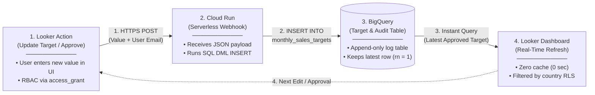

# Minor Hotels — Looker Real-Time BigQuery Write-Back, Approval & RLS/CLS Reference

This repository contains the reference implementation for **Minor Hotels' Hospitality Semantic Layer, Real-Time BigQuery Write-Back, Multi-Stage Approval Workflow, and Row/Column-Level Security (RLS/CLS)** in Looker.

---

## 1. Reference Architecture Diagram (Looker Action $\rightarrow$ Cloud Run $\rightarrow$ BigQuery $\rightarrow$ Looker)

---

## 2. End-to-End Implementation Guide (5 Steps)

LookML (`minor_hotels_analytics.model.lkml` and `views/*.view.lkml`) defines the **semantic layer, interactive write-back/approval forms, and RLS/CLS governance rules**. Below are the 5 components required for an end-to-end setup:

| Step | Component | Implementation Details |
| :--- | :--- | :--- |
| **Step 1** | **BigQuery Append-Only Target Table** | Create an append-only audit log table (`monthly_sales_targets`) in BigQuery (`target_month`, `target_amount`, `updated_by`, `updated_at`, `note`). Using append-only `INSERT` instead of in-place `UPDATE` avoids BigQuery streaming buffer locks and preserves a 100% immutable audit trail of all forecast submissions and approvals (`cloud_run_writeback/setup_bigquery.sql`). |
| **Step 2** | **Cloud Run / Cloud Functions Gen 2 Webhook** | Deploy a lightweight Node.js HTTP endpoint (`POST /action-0/execute` in `cloud_run_writeback/index.js`) that receives Looker's Action JSON payload (`form_params` + server-injected user `email`) and executes a standard SQL `INSERT INTO` against BigQuery (`cloud_run_writeback/deploy.sh`). |
| **Step 3** | **IAM & Service Account Permissions** | Grant the Cloud Run runtime Service Account `roles/bigquery.dataEditor` (on the target write-back dataset) and `roles/bigquery.jobUser` (on the project). |
| **Step 4** | **Looker User Attributes & Access Grants (RLS & CLS)** | • **Row-Level Security (RLS)**: In **Looker Admin > User Attributes**, configure `country`. In `minor_hotels_analytics.model.lkml`, `sql_always_where` filters `${minor_hotel_performance.country}` against `_user_attributes["country"]` (and shows all countries when `NULL` or empty). • **Column-Level Security (CLS) & Approval RBAC**: Configure `access_grant: can_approve_budget` so only authorized approvers (Regional VP / CFO) can see and trigger the Approval Action column (`required_access_grants: [can_approve_budget]`). |
| **Step 5** | **LookML Action & Window-Function View** | Connect the LookML `action:` URL (`views/minor_live_budget_writeback.view.lkml`) to the Cloud Run endpoint, resolve the latest active record per scope using `ROW_NUMBER() OVER (PARTITION BY target_month ORDER BY updated_at DESC) = 1`, and set `persist_for: "0 seconds"` on the Explore for instant dashboard refresh. |

---

## 3. Repository Structure

* [`minor_hotels_analytics.model.lkml`](./minor_hotels_analytics.model.lkml) — LookML model defining the BigQuery connection, `access_grant` definitions (CLS / Approval RBAC), and `sql_always_where` Country RLS.
* [`views/minor_hotel_performance.view.lkml`](./views/minor_hotel_performance.view.lkml) — Core hotel portfolio performance fact view (`eco-shift-478607-e5.minor_hotels_demo.minor_hotel_performance`).
* [`views/minor_live_budget_writeback.view.lkml`](./views/minor_live_budget_writeback.view.lkml) — Live BigQuery Write-Back & Executive Approval Action definitions (`writeback_forecast_override_action`, `executive_approval_decision_action`).
* [`views/minor_approval_workflow.view.lkml`](./views/minor_approval_workflow.view.lkml) — Property-month forecast approval queue and SLA tracking view.
* [`views/minor_brand_targets.view.lkml`](./views/minor_brand_targets.view.lkml) — Brand-level strategic GOP margin, RevPAR, and ESG sustainability hurdles.
* [`views/minor_rls_access_control.view.lkml`](./views/minor_rls_access_control.view.lkml) — Self-service dynamic RLS access request and approval workflow view.
* [`dashboards/minor_hotels_executive.dashboard.lookml`](./dashboards/minor_hotels_executive.dashboard.lookml) — 4-Tab Executive Command Center LookML Dashboard.
* [`cloud_run_writeback/`](./cloud_run_writeback/) — Node.js Cloud Run / Cloud Functions Gen 2 webhook server (`index.js`), deployment script (`deploy.sh`), and BigQuery DDL (`setup_bigquery.sql`).

---

## 4. Official Google Cloud & Looker Documentation

* **LookML `action` Parameter (Native Write-Back Forms & Webhooks)**:
  * https://cloud.google.com/looker/docs/reference/param-field-action
* **Looker Action Hub API Specification (Custom Webhook Endpoints on Cloud Run)**:
  * https://github.com/looker-open-source/actions/blob/master/docs/action_api.md
* **Row-Level Security (RLS) with `sql_always_where` and `user_attribute`**:
  * https://cloud.google.com/looker/docs/reference/param-explore-sql-always-where
  * https://cloud.google.com/looker/docs/admin-panel-users-user-attributes
* **Column-Level Security (CLS) & Action RBAC with `access_grant` and `required_access_grants`**:
  * https://cloud.google.com/looker/docs/reference/param-model-access-grant
  * https://cloud.google.com/looker/docs/reference/param-field-required-access-grants
