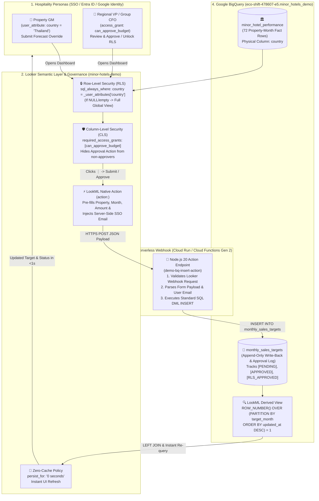

# Minor Hotels — Looker Real-Time Write-Back, RLS/CLS Governance & Dataverse Follow-Up Guide

> [!IMPORTANT]
> **Executive Summary for Customer Follow-Up**
> 1. **End-to-End Write-Back & Approval Architecture**: LookML alone defines the UI form and RBAC, while a lightweight **Cloud Run (Cloud Functions Gen 2)** webhook receives the payload and executes a standard SQL `INSERT INTO` against an **Append-Only BigQuery table** (`monthly_sales_targets`). Total implementation effort is **~2–3 engineering days**.
> 2. **Why Microsoft Dataverse Is Not Needed**: In Power BI, Dataverse + Power Apps + Power Automate are required because Power BI lacks native write-back actions. In **Looker + BigQuery**, both **Live Write-Back** and **Dynamic RLS Lookup** run natively inside BigQuery with zero Power Platform Premium licensing costs and zero cross-cloud latency.
> 3. **If Legacy Dataverse Integration Is Required**: Looker can integrate with Dataverse via **Dataverse Web API (OData v4 / v9.2)** either through **Cloud Run webhook dual-write** (for write-back) or **scheduled ELT sync to BigQuery** (for RLS lookup tables).

---

## 1. Reference Architecture Diagram (Looker Action + Cloud Run + BigQuery)



---

## 2. What Else Is Needed Beyond LookML? (5-Step Implementation & Effort Estimate)

LookML (`minor_hotels_analytics.model.lkml` and `views/*.view.lkml`) provides the **semantic layer, action modal UI, and RLS/CLS security rules**, but **4 additional infrastructure steps** are required to make BigQuery Write-Back work end-to-end:

| Step | Component | What Needs to Be Done | Estimated Effort |
| :--- | :--- | :--- | :--- |
| **Step 1** | **BigQuery Target Table (Append-Only)** | Create an append-only audit log table (`monthly_sales_targets`) in BigQuery (`target_month`, `target_amount`, `updated_by`, `updated_at`, `note`). Append-only `INSERT` avoids BigQuery streaming buffer `UPDATE` locks and preserves 100% audit history. | **0.5 Hours** |
| **Step 2** | **Cloud Run / Cloud Functions Gen 2 Webhook** | Deploy a lightweight Node.js or Python HTTP endpoint (`POST /action-0/execute`) that accepts Looker's Action JSON payload (`form_params` + `data`) and executes `INSERT INTO ... VALUES (...)` via the BigQuery client library. *(Tip: Use a `*.cloudfunctions.net` or Custom Load Balancer domain so DNS responses return a single Anycast IP).* | **4 Hours (0.5 Days)** |
| **Step 3** | **IAM & Service Account Permissions** | Grant the Cloud Run runtime Service Account `roles/bigquery.dataEditor` (on the target write-back dataset) and `roles/bigquery.jobUser` (on the project). Configure authentication validation between Looker and Cloud Run. | **2 Hours** |
| **Step 4** | **Looker User Attributes & Access Grants** | In **Looker Admin > User Attributes**, create `country` (mapped to SSO/SAML/OIDC group or user claims) for RLS, and configure `access_grant` (`can_approve_budget`) for CLS approval gating. | **2 Hours** |
| **Step 5** | **LookML Action & Window-Function View** | Connect the LookML `action:` URL to the Cloud Run endpoint, join the latest write-back row via `ROW_NUMBER() OVER (PARTITION BY ... ORDER BY updated_at DESC) = 1`, and set `persist_for: "0 seconds"` on the Explore. | **4 Hours (0.5 Days)** |
| **Total** | **End-to-End POC Implementation** | **Full production-grade setup in customer's non-prod GCP environment** | **~1.5 to 2 Days** |

---

## 3. BigQuery Connection Cost-Tagging Recommendations (POC Usage Tracking)

To accurately track and isolate Looker POC query and write-back costs inside Minor Hotels' **non-prod GCP project**, we recommend implementing the following **3-tier cost attribution setup**:

### Recommendation A: Dedicated Service Account per Looker Connection
1. Create two dedicated Service Accounts in the non-prod GCP project:
   * `sa-looker-poc-query@<nonprod-project>.iam.gserviceaccount.com` (assigned to the Looker BigQuery Connection)
   * `sa-looker-poc-writeback@<nonprod-project>.iam.gserviceaccount.com` (assigned to the Cloud Run Write-Back service)
2. Every BigQuery slot-ms and byte billed by the POC is immediately isolated under `user_email` in `INFORMATION_SCHEMA.JOBS_BY_PROJECT`.

### Recommendation B: Leverage Looker's Native Query Context Comments
In **Looker Admin $\rightarrow$ Database $\rightarrow$ Connections $\rightarrow$ Edit Connection**, ensure **Disable Context Comment** is **unchecked** (default).
* Looker automatically appends a structured JSON comment to the end of every SQL query sent to BigQuery:
  ```sql
  -- Looker Query Context '{"user_id":1,"history_slug":"...","instance_slug":"..."}'
  ```
* Your data engineering team can run the following query in BigQuery to audit exact POC cost by Looker user, model, or dashboard vs. write-back DML operations:

```sql
SELECT
  DATE(creation_time) AS usage_date,
  user_email AS service_account,
  statement_type,
  COUNT(1) AS total_queries,
  ROUND(SUM(total_bytes_billed) / POW(1024, 3), 4) AS total_gb_billed,
  -- Estimate on-demand cost at $6.25 per TB
  ROUND((SUM(total_bytes_billed) / POW(1024, 4)) * 6.25, 4) AS estimated_cost_usd
FROM `region-us`.INFORMATION_SCHEMA.JOBS_BY_PROJECT
WHERE creation_time >= TIMESTAMP_SUB(CURRENT_TIMESTAMP(), INTERVAL 30 DAY)
  AND (
    query LIKE '%minor_hotels_demo%'
    OR query LIKE '%Looker Query Context%'
  )
GROUP BY 1, 2, 3
ORDER BY usage_date DESC, total_gb_billed DESC;
```

### Recommendation C: GCP Resource Labels for Cloud Billing Export
Apply standard GCP resource labels (`env: poc`, `workload: looker-minor-hotels`, `component: bi-writeback`) to:
1. The BigQuery dataset (`minor_hotels_demo`)
2. The Cloud Run / Cloud Functions Gen 2 service (`demo-bq-insert-action`)
This allows finance/IT teams to filter `gcp_billing_export_resource_v1_*` directly by `labels.value = 'looker-minor-hotels'`.

---

## 4. Microsoft Dataverse Follow-Up: Do We Need Dataverse for Write-Back & Dynamic RLS?

### Why the Customer Currently Uses Dataverse (Power BI Legacy Context)
In the Microsoft Power Platform ecosystem, **Power BI is read-only** and cannot natively execute write-back or self-service approval workflows. Consequently, customers using Power BI are forced to purchase and maintain **4 separate products**:
1. **Power BI** (Visualization)
2. **Power Apps** (Embedded canvas form for budget input)
3. **Power Automate** (Approval workflow trigger)
4. **Microsoft Dataverse** (Backend storage for write-back rows and Dynamic RLS user-region mapping tables)

> [!TIP]
> **Key Message to Minor Hotels & Deloitte**:
> **You do NOT need Microsoft Dataverse when moving to Looker + BigQuery.** Storing write-back targets and Dynamic RLS entitlements directly in **BigQuery** eliminates Power Apps / Dataverse Premium per-user licensing costs (\$15–\$20/user/month), removes Dataverse API throttling limits, and eliminates cross-cloud latency between GCP and Azure.

### Architectural Comparison: Power BI + Dataverse vs. Looker + BigQuery

| Capability | Legacy: Power BI + Dataverse + Power Apps | Recommended: Looker + Cloud Run + BigQuery |
| :--- | :--- | :--- |
| **Write-Back UI** | Requires embedding a separate **Power Apps** widget inside the dashboard | Native **LookML `action:`** form built directly into any dimension/measure |
| **Approval Workflow** | Requires **Power Automate** flows + Dataverse status columns | Native **LookML `action:` + `required_access_grants`** + BigQuery status log |
| **Storage Engine** | **Microsoft Dataverse** (extra capacity cost + API limits) | **Google BigQuery** (same warehouse as hotel performance data) |
| **Dynamic RLS Lookup** | Power BI queries Dataverse over OData/DirectQuery and joins in memory | Looker `sql_always_where` evaluates `user_attribute: country` (or BigQuery entitlement table) natively in SQL |
| **Extra Licensing** | Power Apps Premium / Dataverse capacity add-ons required | **\$0 extra license** (uses existing BigQuery + pennies for Cloud Run invocations) |

### What If Minor Hotels *Must* Integrate with Existing Dataverse Tables? (3 Options)

If Minor Hotels already maintains master data or user-country mappings inside **Dynamics 365 / Microsoft Dataverse** and wants to connect it during a phased migration, here are the 3 technical interface options:

1. **Option 1 — Full Native Replacement in BigQuery (Recommended)**
   * Migrate the static/semi-static RLS mapping table and Budget Write-Back table into **BigQuery** (`minor_hotels_demo`).
   * **Effort**: Lowest (~1–2 days). **Performance**: Fastest (<1s). **Cost**: Lowest.
2. **Option 2 — Dataverse as Upstream Master for RLS (ELT Sync to BigQuery)**
   * *Avoid querying Dataverse OData API live on every Looker query* (Dataverse Web API has strict concurrency/throttling limits and adds 1–3s cross-cloud latency).
   * Instead, sync the Dataverse RLS table to BigQuery every 5–15 minutes using **Azure Synapse Link for Dataverse / Fabric Export**, **BigQuery Data Transfer / Cloud Composer**, or a lightweight **Cloud Run cron job querying the Dataverse Web API (`GET https://<org>.crm.dynamics.com/api/data/v9.2/<entity>`)** using Microsoft Entra ID OAuth 2.0 Client Credentials.
   * Looker then enforces RLS against the synced BigQuery table at native BigQuery speed.
3. **Option 3 — Live Write-Back from Looker to Dataverse Web API (Hybrid Dual-Write)**
   * If budget overrides submitted in Looker must also update an upstream Dynamics 365 / Dataverse entity in real time, our **Cloud Run Action Webhook** can authenticate to Microsoft Entra ID (`https://login.microsoftonline.com/<tenant_id>/oauth2/v2.0/token`) and send an OData `POST` / `PATCH` request directly to the **Microsoft Dataverse Web API (`/api/data/v9.2/<entity_set>`)** alongside the BigQuery `INSERT`.

---

## 5. Official Google Cloud & Looker Documentation Links

* **LookML `action` Parameter (Native Write-Back Forms & Webhooks)**:
  * https://cloud.google.com/looker/docs/reference/param-field-action
* **Looker Action Hub API Specification (Building Custom Webhook Endpoints on Cloud Run)**:
  * https://github.com/looker-open-source/actions/blob/master/docs/action_api.md
* **Row-Level Security (RLS) with `sql_always_where` and `user_attribute`**:
  * https://cloud.google.com/looker/docs/reference/param-explore-sql-always-where
  * https://cloud.google.com/looker/docs/reference/param-explore-access-filter
  * https://cloud.google.com/looker/docs/admin-panel-users-user-attributes
* **Column-Level Security (CLS) & Action RBAC with `access_grant` and `required_access_grants`**:
  * https://cloud.google.com/looker/docs/reference/param-model-access-grant
  * https://cloud.google.com/looker/docs/reference/param-field-required-access-grants
* **Looker to BigQuery Connection Setup & Query Context Comments (Cost Attribution)**:
  * https://cloud.google.com/looker/docs/db-config-google-bigquery
  * https://cloud.google.com/looker/docs/admin-panel-database-queries#query_context_comments
* **BigQuery Job Labels & `INFORMATION_SCHEMA.JOBS_BY_PROJECT` Cost Monitoring**:
  * https://cloud.google.com/bigquery/docs/labels-intro
  * https://cloud.google.com/bigquery/docs/information-schema-jobs
* **Microsoft Dataverse Web API (OData v4 / v9.2) Reference (For Hybrid Option 2/3)**:
  * https://learn.microsoft.com/en-us/power-apps/developer/data-platform/webapi/overview
